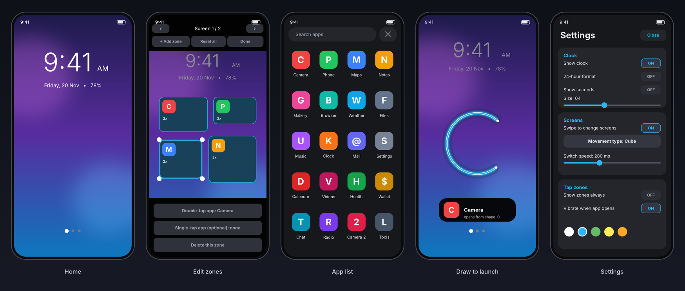

# 📳 ZoneX-launcher

A lightweight, fully **offline** Android launcher where you place invisible tap zones anywhere on your home screen and make each one open an app of your choice.(Fully safe)

No internet. No ads. No tracking.

---

## ✨ Features

- **ZoneX-launcher** – place as many as you like, move and resize them freely
- **Double-tap or single-tap** to open a different app from each zone
- **Multiple screens** – every screen has its own zones, and empty screens disappear automatically
- **screen movements** – Normal, Cube, Zoom, Fade, Rotate, Flip, Stack, Depth, Accordion
- **Digital clock** – 12/24-hour, day and date, battery %, custom size, color and position
- **Draw to launch** – draw a shape and the app you saved for it opens
---

## 🖐️ Gestures

| Gesture | Action |
|---|---|
| Double-tap a zone | Open its app |
| Single-tap a zone | Open its optional second app |
| Swipe left / right | Change screen |
| Swipe up | App list |
| Swipe down | Notifications |
| Draw a saved shape | Open the matching app |
| Hold ~1 second | Edit mode (add, move, resize zones) |
| Hold 5 seconds | Settings |

---
## 📸 Screenshots

---

## 📲 How to Install
1) Open the Releases section of this repo.
Under the latest release, download app-debug.apk from Assets.
2) Open the downloaded file and tap Install (allow "Install unknown apps" if your phone asks).
3) Press Home and choose Tap Zones as your default home app.
4) Google Play Protect may warn about apps installed outside the Play Store. This is expected for self-built apps.
---

## 🧱 Tech used! 

Kotlin · Android SDK only (no third-party libraries) · custom Canvas views · data stored locally with SharedPreferences

---

*Built for fun.*
